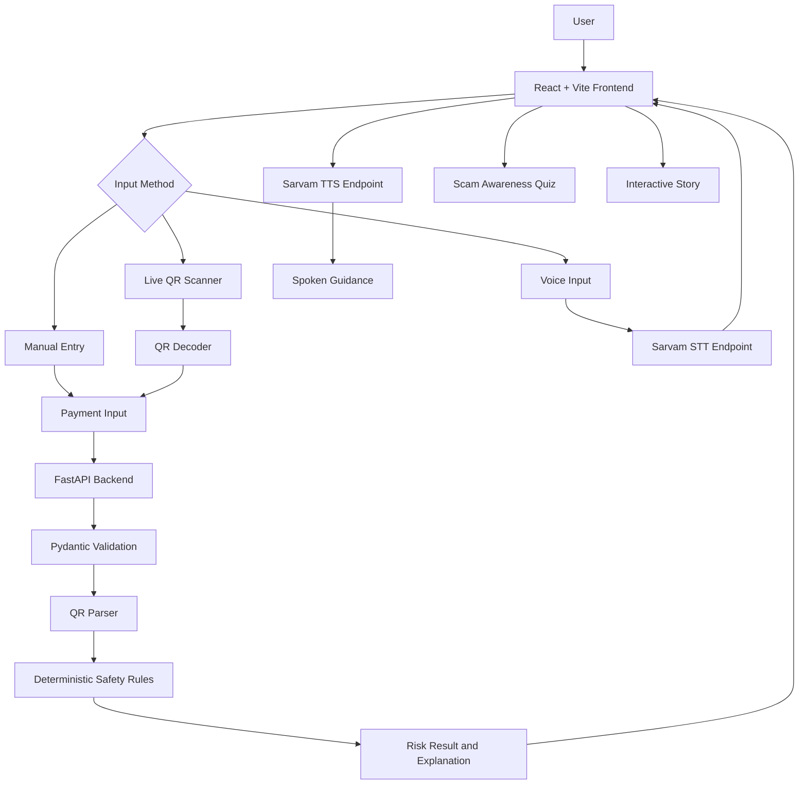

# 🛡️ SAARTHI SafePay
### Easy Pay. Safe Pay.

**An accessible, voice-enabled digital payment safety assistant designed to help older adults understand QR-based payments, recognize suspicious situations, and make informed decisions before proceeding.**

> **Track:** C – Digital Inclusion & Public Access  
> **Problem Statement:** 8 – Easy Pay, Safe Pay  
> **Duration:** 24-Hour Hackathon  
> **Domains:** Cybersecurity · Digital Inclusion · Payment Safety · Accessibility

---

## 📌 Table of Contents

1. [Overview](#-overview)
2. [Problem Statement](#-problem-statement)
3. [Our Solution](#-our-solution)
4. [Key Features](#-key-features)
5. [Technology Stack](#-technology-stack)
6. [System Architecture](#-system-architecture)
7. [Application Workflow](#-application-workflow)
8. [Security and Risk Analysis](#-security-and-risk-analysis)
9. [API Design](#-api-design)
10. [Project Structure](#-project-structure)
11. [Team Responsibilities](#-team-responsibilities)
12. [Testing Strategy](#-testing-strategy)
13. [24-Hour Development Roadmap](#-24-hour-development-roadmap)
14. [Learning and Awareness Module](#-learning-and-awareness-module)
15. [Accessibility and Language Support](#-accessibility-and-language-support)
16. [Privacy and Security](#-privacy-and-security)
17. [Setup and Installation](#-setup-and-installation)
18. [Environment Variables](#-environment-variables)
19. [Deployment](#-deployment)
20. [Limitations and Future Scope](#-limitations-and-future-scope)
21. [Demo Plan](#-demo-plan)
22. [Team](#-team)

---

## 🎯 Overview

Digital payments have made everyday transactions faster and more convenient. However, older adults and less digitally experienced users may find it difficult to distinguish legitimate payment requests from suspicious situations.

**SAARTHI SafePay** provides a simple, accessible safety layer that helps users understand supported QR-based payment information before proceeding independently.

Users can scan a QR code, review the available payment details, select their intended action, and receive understandable explanations of potential warning signs.

### Our objectives

- Make digital payment interactions easier to understand.
- Help users recognize common suspicious situations.
- Provide explainable, deterministic safety checks.
- Improve accessibility through voice assistance and multilingual support.
- Encourage safer digital habits through interactive education.
- Protect user privacy by avoiding the collection of sensitive banking credentials.

---

## 🚨 Problem Statement

Older adults and digitally inexperienced users may encounter several challenges when using digital payment systems:

- Confusion between sending and receiving money.
- Difficulty understanding QR code payment information.
- Fraudulent requests involving urgency, threats, or impersonation.
- Requests for sensitive information such as UPI PINs and OTPs.
- Language barriers and complicated interfaces.
- Difficulty understanding technical warnings and errors.

### Our challenge

Build an accessible digital assistant that helps users understand payment information, recognize suspicious situations, and learn safer digital payment practices.

---

## 💡 Our Solution

SAARTHI SafePay provides a guided payment safety experience.

Instead of immediately proceeding with a payment, users can inspect supported QR data and receive clear guidance about inconsistencies, reported warning signs, and information that could not be verified.

### How it works

1. **Scan:** Read a supported payment QR code using the device camera.
2. **Enter:** Use manual entry if camera access is unavailable.
3. **Choose:** Select whether the intention is to pay or receive money.
4. **Analyze:** Validate supported payment information using deterministic rules.
5. **Understand:** Review the recipient, amount, warnings, and limitations.
6. **Act safely:** Verify the details independently before proceeding.
7. **Learn:** Practice recognizing suspicious situations through educational scenarios.

> **SAARTHI SafePay is a payment safety assistant, not a payment processor or a guarantee of fraud detection.**

---

## ✨ Key Features

### 1. QR Code Scanner

- Live camera-based QR scanning.
- Browser-based QR decoding using `@zxing/browser`.
- Support for compatible UPI payment QR formats.
- Manual entry fallback.
- Handling for malformed and unsupported QR data.
- No automatic payment initiation.

### 2. Pay or Receive Intent Selection

Users explicitly select their intended action before analysis.

The application checks whether the decoded QR information appears consistent with that intent.

For example, if a user wants to receive money but scans a QR representing a payment request, the application explains the mismatch and advises the user not to use that QR to receive money.

### 3. Explainable Safety Analysis

A deterministic rules engine evaluates supported payment information and predefined warning conditions.

Possible outcomes:

- **Low Concern:** No configured warning was triggered.
- **Caution:** An inconsistency requires verification.
- **High Concern:** A warning condition warrants stopping and checking.
- **Unverified:** The information is insufficient or unsupported.

Every result includes an explanation and recommended next steps.

> A low-concern result does not guarantee that a payment or recipient is safe.

### 4. Voice Assistance

Powered by Sarvam AI speech services, planned capabilities include:

- Speech-to-text for short spoken instructions.
- Text-to-speech for payment details and safety guidance.
- Voice-assisted interaction in supported languages.
- Text fallback when speech services are unavailable.

Voice input is treated as user-provided information and does not independently establish that a payment is safe.

### 5. Multilingual Interface

Planned languages:

- 🇬🇧 English
- 🇮🇳 Hindi
- 🇮🇳 Kannada

Core interface text and critical safety messages will use reviewed translations. Voice capabilities will be enabled only for language paths tested during development.

### 6. Scam Awareness Quiz

A short interactive quiz teaches users to identify common suspicious situations.

Each question includes:

- A fictional scenario.
- Clear answer choices.
- Immediate feedback.
- An explanation of the warning sign.
- A recommended safe action.

### 7. Interactive Safety Story

If time permits, users can explore a short branching story about a suspicious payment request.

Different choices demonstrate different consequences and reinforce safer habits.

### 8. Accessible Interface

- Large, readable text.
- Clear labels and instructions.
- Large touch-friendly buttons.
- High contrast and uncluttered layouts.
- Simple navigation.
- Understandable warnings.
- Visible loading and error states.

---

## 🧰 Technology Stack

| Component | Technology |
|---|---|
| Frontend | React |
| Language | TypeScript |
| Build tool | Vite |
| Styling | Tailwind CSS |
| QR scanning | `@zxing/browser` |
| Backend | Python FastAPI |
| Validation | Pydantic |
| Speech-to-text | Sarvam AI `saaras:v4` |
| Text-to-speech | Sarvam AI `bulbul:v3` |
| Frontend hosting | Vercel |
| Backend hosting | Render |
| Testing | Pytest and browser/device testing |
| Version control | Git and GitHub |

### Technology principles

- Keep the implementation small and maintainable.
- Use deterministic rules for safety decisions.
- Keep external API keys on the backend.
- Avoid unnecessary databases and authentication systems.
- Preserve core functionality when optional services fail.

---

## 🏗️ System Architecture



### Frontend responsibilities

- User interface and navigation.
- Camera permissions and QR scanning.
- Manual entry.
- Intent selection.
- Risk result display.
- Language selection and voice controls.
- Learning experiences.

### Backend responsibilities

- Input validation.
- Supported QR parsing.
- Deterministic risk analysis.
- Structured explanations.
- Sarvam speech API integration.
- Safe error handling.

### Safety engine responsibilities

- Produce the application risk classification.
- Apply explicit, testable rules.
- Prevent AI-generated text from overriding the result.
- Treat missing or unsupported information as unverified.

---

## 🔄 Application Workflow

1. The user opens SAARTHI SafePay.
2. The user selects a preferred language.
3. The user chooses **Pay** or **Receive**.
4. The user scans a supported QR code or enters payment information manually.
5. The frontend submits the decoded information and selected intent to FastAPI.
6. The backend validates the input and parses supported fields.
7. The rules engine evaluates intent mismatches, amount discrepancies, reported concerns, and missing information.
8. The backend returns a structured response.
9. The frontend displays the result and explanation.
10. The user verifies the information independently before proceeding.

### Error handling

- If camera access fails, manual entry remains available.
- If a QR cannot be parsed, the application explains that it cannot verify the information.
- If the backend is unavailable, the interface offers a retry.
- If Sarvam services fail, text-based functionality remains available.

---

## 🛡️ Security and Risk Analysis

The safety engine is the central technical component of SAARTHI SafePay.

### Risk rules

| Condition | Expected behavior |
|---|---|
| Malformed or unsupported QR | Return `unverified` |
| Required payment address missing | Return `unverified` |
| Receive intent conflicts with a payment request | Explain the mismatch and advise against using that QR to receive money |
| Expected amount differs from QR amount | Display the discrepancy and request verification |
| User reports being asked for a PIN or OTP | Display a strong warning and safe next steps |
| User reports pressure, threats, or urgency | Recommend stopping and independently verifying the request |
| Supported data parses successfully with no configured warning | Return `low_concern` and display the payment details |

### Explainable outcomes

Every analysis response should provide:

- Risk classification.
- Decision guidance.
- Parsed payment information.
- Triggered rule codes.
- Human-readable explanation.
- Recommended next steps.

### Security limitations

SAARTHI SafePay does not claim to:

- Verify the identity of every recipient.
- Detect every fraudulent QR code.
- Access bank-side transaction intelligence.
- Guarantee transaction safety.
- Block payments made outside the application.
- Replace banks or official fraud reporting channels.

An unfamiliar recipient alone is not sufficient evidence of fraud.

---

## 🔌 API Design

Base path:

```text
/api/v1
```

### 1. Health Check

**Endpoint:** `GET /health`

Example response:

```json
{
  "status": "ok",
  "service": "saarthi-safepay"
}
```

### 2. Analyze Payment Information

**Endpoint:** `POST /api/v1/analyze-payment`

Example request:

```json
{
  "intent": "receive",
  "qr_text": "upi://pay?pa=merchant@example&pn=Demo%20Merchant",
  "expected_amount": null,
  "language": "en",
  "reported_concerns": []
}
```

Example response:

```json
{
  "risk_level": "caution",
  "decision": "verify_before_proceeding",
  "recipient": "Demo Merchant",
  "payment_address": "merchant@example",
  "amount": null,
  "currency": "INR",
  "checks": [
    {
      "code": "RECEIVE_PAY_MISMATCH",
      "passed": false
    }
  ],
  "explanation": "This QR appears to request a payment, but you selected Receive.",
  "next_steps": [
    "Do not proceed with this QR for receiving money.",
    "Confirm the intended action independently."
  ]
}
```

*This response is illustrative. The backend must calculate the actual result from validated input and implemented rules.*

#### Request fields

| Field | Type | Description |
|---|---|---|
| `intent` | String | `pay` or `receive` |
| `qr_text` | String | Decoded QR content or manually supplied supported payment data |
| `expected_amount` | Number or null | Optional amount the user expects to pay |
| `language` | String | `en`, `hi`, or `kn` |
| `reported_concerns` | Array | Optional predefined concerns reported by the user |

Never accept a UPI PIN, OTP, or password in this request.

#### Risk levels

- `low_concern`
- `caution`
- `high_concern`
- `unverified`

#### Decision values

- `review_details`
- `verify_before_proceeding`
- `stop_and_check`
- `unable_to_verify`

### 3. Speech-to-Text

**Endpoint:** `POST /api/v1/speech-to-text`

Request: multipart form data.

| Field | Description |
|---|---|
| `file` | Recorded audio file |
| `language` | Supported language code |

Example response:

```json
{
  "text": "I want to receive money",
  "language": "en"
}
```

### 4. Text-to-Speech

**Endpoint:** `POST /api/v1/text-to-speech`

Example request:

```json
{
  "text": "Please check the recipient and payment amount before proceeding.",
  "language": "en"
}
```

The implementation should document whether it returns audio bytes or JSON containing encoded audio.

### API error handling

| HTTP status | Meaning |
|---|---|
| `400` | Invalid request |
| `413` | Request or audio file too large |
| `422` | Schema validation error |
| `502` | Upstream speech provider failure |
| `503` | Optional service unavailable |

The backend must not expose API keys, provider secrets, or internal stack traces.

---

## 📁 Project Structure

```text
saarthi-safepay/
├── frontend/
│   ├── src/
│   │   ├── components/
│   │   │   ├── QRScanner.tsx
│   │   │   ├── PaymentSummary.tsx
│   │   │   ├── RiskResult.tsx
│   │   │   └── VoiceControls.tsx
│   │   ├── pages/
│   │   │   ├── Home.tsx
│   │   │   ├── Analyze.tsx
│   │   │   ├── Learn.tsx
│   │   │   └── Story.tsx
│   │   ├── services/
│   │   │   └── api.ts
│   │   ├── data/
│   │   │   └── scenarios.ts
│   │   ├── i18n/
│   │   │   └── messages.ts
│   │   ├── App.tsx
│   │   └── main.tsx
│   └── package.json
│
├── backend/
│   ├── app/
│   │   ├── main.py
│   │   ├── schemas.py
│   │   ├── api/
│   │   │   ├── payments.py
│   │   │   └── speech.py
│   │   ├── security/
│   │   │   ├── parser.py
│   │   │   ├── rules.py
│   │   │   └── explanations.py
│   │   └── services/
│   │       └── sarvam.py
│   ├── tests/
│   │   ├── test_parser.py
│   │   ├── test_rules.py
│   │   └── test_api.py
│   └── requirements.txt
│
├── README.md
└── .gitignore
```

This is a suggested starting structure. Files can be combined if necessary to keep the implementation manageable.

---

## 👥 Team Responsibilities

### Meer Mohammed Shoaib — Security and Backend Lead

**Primary responsibility:** Explainable safety analysis.

- Set up FastAPI and Pydantic schemas.
- Implement supported QR parsing.
- Develop deterministic security rules.
- Create risk explanations and response codes.
- Write backend unit tests.
- Coordinate backend Sarvam integration.
- Explain the security design and limitations during judging.

**Deliverable:** A tested backend analyzer with predictable, explainable outcomes.

### Rishitha — Frontend and Accessibility

**Primary responsibility:** Accessible user experience.

- Set up React, Vite, TypeScript, and Tailwind CSS.
- Build the home screen and intent selection.
- Develop payment summary and result screens.
- Implement language selection and readable safety messages.
- Integrate frontend API calls.
- Handle loading, validation, and failure states.
- Test large-text and touch-friendly usability.

**Deliverable:** An accessible frontend that works with mock and live backend responses.

### Ritu — QR Scanning, Voice, and Learning

**Primary responsibility:** Input workflows and educational experiences.

- Implement live camera QR scanning.
- Add manual entry fallback.
- Handle camera permissions and scanner errors.
- Integrate voice controls with backend endpoints.
- Test Sarvam STT and TTS.
- Build the Scam or Safe quiz.
- Add the interactive story if time permits.

**Deliverable:** A working QR input journey, tested voice interactions where available, and a compact learning module.

### Collaboration rules

- Agree on the API contract before independent implementation.
- Use mock responses to avoid blocking frontend development.
- Commit working changes frequently.
- Use separate branches and small pull requests.
- Integrate early and test on the actual demo device.
- Help the teammate who is blocked by an integration issue.

---

## 🧪 Testing Strategy

### Backend tests

| Test | Expected result |
|---|---|
| Valid supported QR | Parsed fields returned accurately |
| QR contains amount | Correct amount displayed |
| QR has no amount | Amount remains unknown |
| Malformed QR | Unverified result; no crash |
| Unsupported scheme | Clear unsupported-format response |
| Missing payment address | Unverified result |
| Receive intent conflicts with payment request | Clear mismatch warning |
| Expected amount differs | Discrepancy displayed |
| User reports PIN/OTP request | Strong warning |
| User reports pressure or threats | Warning and independent verification guidance |
| Invalid or unexpected input | Safely rejected or handled |
| Sarvam unavailable | Voice failure handled gracefully |
| Unsupported language code | Validation error or documented fallback |
| Oversized audio | Request rejected |

### Frontend and device tests

- [ ] Camera permission granted.
- [ ] Camera permission denied.
- [ ] No camera available.
- [ ] QR cannot be decoded.
- [ ] Manual entry works without camera access.
- [ ] Backend offline.
- [ ] API returns an error.
- [ ] Language switching works.
- [ ] Safety messages remain readable.
- [ ] Voice playback and retry behavior work.
- [ ] Keyboard navigation and large-text usability.
- [ ] Mobile viewport and touch interactions.

### Definition of Done

- [ ] Live QR scanning works.
- [ ] Manual entry works.
- [ ] Pay/Receive intent is explicit.
- [ ] Identical input produces the same rules-engine result.
- [ ] Invalid input never silently becomes safe.
- [ ] Results include explanations and next steps.
- [ ] No PIN, OTP, or password is collected or stored.
- [ ] Frontend handles API and voice failures.
- [ ] Core language paths have been tested.
- [ ] The application runs reliably on the demo device.

Testing claims must reflect the scenarios actually executed. Do not claim a fraud-detection accuracy percentage without a representative, labelled dataset.

---

## ⏱️ 24-Hour Development Roadmap

| Time | Phase | Deliverables |
|---|---|---|
| 00–02 | Setup and contracts | Repository, app skeleton, API schema, rules, QR fixtures |
| 02–06 | Parallel implementation | Initial backend rules, accessible UI, QR scanner |
| 06–11 | Core integration | Scan → parse → analyze → display result |
| 11–14 | Reliability | Error handling, intent mismatch, amount comparison, accessibility |
| 14–17 | Voice and languages | Sarvam STT/TTS, reviewed translations, text fallback |
| 17–19 | Learning module | Quiz completed; interactive story if time permits |
| 19–22 | Regression and deployment | Device testing, deployment attempt, backup demo recording |
| 22–24 | Freeze and pitch | No new features, demo rehearsal, final checks |

### Critical cutoff rules

- If scan-to-analysis is unreliable by hour 11, postpone voice integration and games.
- If Sarvam is unstable by hour 17, preserve the text fallback and focus on testing.
- Freeze new features by hour 19.
- Reserve the final two hours for demo preparation and troubleshooting.

---

## 🎮 Learning and Awareness Module

### Scam or Safe? Quiz

The quiz uses three to five fictional scenarios, such as:

- Someone asks for a UPI PIN to receive money.
- A caller demands an urgent payment.
- A QR is presented with a clearly stated amount.
- A person encourages independent recipient verification.

Each question provides immediate feedback and explains the safer response.

Implementation:

- Static JSON scenarios.
- Large answer buttons.
- Immediate feedback.
- Score and replay option.
- No database required.

### Interactive Story

If the core application is stable, build one short branching story about a suspicious payment request.

Users choose between actions such as:

- Acting immediately.
- Checking the recipient independently.
- Asking a trusted person for help.

Each branch demonstrates a consequence and a lesson.

A completed quiz is more valuable than two unfinished learning features.

---

## 🌐 Accessibility and Language Support

The application targets older adults and users with varying levels of digital literacy.

### Accessibility principles

- Use readable font sizes.
- Keep instructions short and clear.
- Provide large touch targets.
- Use consistent navigation.
- Avoid relying on color alone to communicate risk.
- Provide clear error messages.
- Offer manual entry as a scanner alternative.
- Allow users to read warnings without using voice features.

### Language support

The planned languages are English, Hindi, and Kannada.

Implementation priorities:

1. Translate core navigation and instructions.
2. Prepare reviewed translations for critical warnings.
3. Test the selected language throughout the payment flow.
4. Enable speech services only for tested language paths.
5. Preserve readable text if voice recognition or playback fails.

Do not rely on unreviewed dynamic translation for critical safety warnings.

---

## 🔐 Privacy and Security

SAARTHI SafePay follows a privacy-first approach.

- Never collect or store UPI PINs.
- Never collect or store OTPs.
- Never request banking passwords.
- Keep Sarvam API keys on the backend.
- Validate all client-supplied data.
- Treat QR content, OCR text, and speech transcripts as untrusted input.
- Avoid storing payment information unnecessarily.
- Use HTTPS for deployed camera and microphone access.
- Restrict backend CORS to intended origins.
- Limit audio upload size.
- Avoid exposing stack traces or secrets.
- Use fictional payment data for testing and demonstrations.

The application does not initiate, authorize, or complete financial transactions.

---

## 💻 Setup and Installation

### Prerequisites

- Node.js and npm.
- Python 3.11 or later.
- Git.
- A modern browser.
- A Sarvam API account and key for voice features.

### 1. Clone the repository

```bash
git clone https://github.com/YOUR_USERNAME/saarthi-safepay.git
cd saarthi-safepay
```

Replace `YOUR_USERNAME` with the GitHub username that owns the repository.

### 2. Set up the frontend

```bash
cd frontend
npm install
npm install @zxing/browser
npm run dev
```

Open the local URL displayed by Vite.

### 3. Set up the backend

Open another terminal:

```bash
cd backend
python -m venv .venv
```

Activate the virtual environment.

**Windows PowerShell:**

```powershell
.venv\Scripts\Activate.ps1
```

**Windows Command Prompt:**

```bat
.venv\Scripts\activate.bat
```

**macOS/Linux:**

```bash
source .venv/bin/activate
```

Install dependencies:

```bash
pip install fastapi uvicorn pydantic httpx python-multipart pytest
```

Install any additional dependencies required by the Sarvam SDK version selected for the implementation.

Start the API:

```bash
uvicorn app.main:app --reload
```

The API will typically be available at:

```text
http://127.0.0.1:8000
```

FastAPI's interactive API documentation is typically available at:

```text
http://127.0.0.1:8000/docs
```

### 4. Run tests

From the backend directory:

```bash
pytest
```

The commands above establish the development environment. They assume the corresponding application files and routes have been implemented.

---

## 🔑 Environment Variables

Create a local `.env` file in the backend directory.

Example:

```env
SARVAM_API_KEY=your_sarvam_api_key
FRONTEND_ORIGIN=http://localhost:5173
```

Use these variables in backend configuration.

**Important:**

- Never commit `.env` to GitHub.
- Add `.env` and other secret files to `.gitignore`.
- Store production secrets in the hosting provider's environment settings.
- Do not expose `SARVAM_API_KEY` in frontend code or Vite environment variables.

Example `.gitignore` entries:

```gitignore
node_modules/
dist/
.venv/
__pycache__/
*.py[cod]
.env
.env.*
!.env.example
.pytest_cache/
```

Keep `.env.example` limited to variable names and harmless placeholder values.

---

## 🚀 Deployment

### Frontend: Vercel

1. Push the frontend code to GitHub.
2. Import the repository into Vercel.
3. Set the frontend project root to `frontend`.
4. Configure the production API base URL.
5. Deploy and test the hosted application.

### Backend: Render

1. Push the backend code to GitHub.
2. Create a web service in Render.
3. Set the backend root directory to `backend`.
4. Configure the Python environment and dependencies.
5. Configure environment variables securely.
6. Use a start command such as:

```bash
uvicorn app.main:app --host 0.0.0.0 --port $PORT
```

7. Test `/health` and the implemented API endpoints.

### Deployment considerations

- Use HTTPS for live camera and microphone access.
- Configure CORS for the actual frontend origin.
- Set the frontend API base URL to the deployed backend.
- Verify audio upload limits and provider access.
- Test the entire flow on the demo device.
- Keep a local fallback and backup recording.

Deployment is optional if it would compromise core functionality or testing time.

---

## 🔮 Limitations and Future Scope

### Current limitations

- QR analysis is limited to supported formats.
- The rules engine cannot identify every fraudulent transaction.
- Recipient identity may not be independently verifiable.
- Speech recognition depends on service availability and language support.
- No live bank-side fraud intelligence is assumed.
- The application does not process payments.

### Future enhancements

- Additional regional languages.
- More sophisticated but explainable fraud indicators.
- Improved accessibility and voice interaction.
- Additional educational scenarios.
- Optional PWA installation.
- Privacy-preserving progress tracking.
- Trusted-contact assistance with explicit user consent.
- Integration with verified external resources and official reporting channels.

These are future possibilities, not claims about currently implemented functionality.

---

## 🎤 Demo Plan

### Suggested 90-second demonstration

1. **Introduce the problem:** Digital payments can be intimidating when users are unsure what a QR code will do.
2. **Scan a demo QR:** Display the decoded recipient and amount, if available.
3. **Demonstrate an intent mismatch:** Select Receive for a payment-request QR and show the warning.
4. **Explain the result:** Highlight the rule that triggered the warning and the recommended next steps.
5. **Show accessibility:** Switch language and demonstrate voice assistance if tested.
6. **Finish with learning:** Complete a short Scam or Safe quiz question.

Use fictional examples and label simulated cases honestly.

Do not claim that a QR code has been verified against a bank or live fraud database unless that capability has actually been implemented.

### What to emphasize to judges

- **Accessibility:** Older adults are the primary users, not an afterthought.
- **Explainable safety:** Warnings have understandable reasons.
- **Responsible design:** No credentials, automatic payments, or unsupported guarantees.
- **Resilience:** Manual entry and text guidance work when optional services fail.
- **Education:** The application helps users develop safer habits.

---

## 👥 Team

| Team Member | Responsibility |
|---|---|
| Meer Mohammed Shoaib | Security rules, backend, validation, testing |
| Rishitha | React frontend, accessibility, API integration |
| Ritu | QR scanning, voice integration, learning module |

---

## 📌 Project Status

**Development stage:** Hackathon MVP.

Planned implementation priorities:

- [ ] QR scanning and manual entry.
- [ ] Deterministic payment safety engine.
- [ ] Explainable risk results.
- [ ] Accessible frontend.
- [ ] English, Hindi, and Kannada core messages.
- [ ] Sarvam speech integration.
- [ ] Scam awareness quiz.
- [ ] Interactive story, if time permits.
- [ ] Regression testing.
- [ ] Deployment and demo rehearsal.

Features should be marked complete only after they have been implemented and tested.

---

### SAARTHI SafePay 🛡️

**Easy Pay. Safe Pay.**

*Helping people navigate digital payments with greater clarity, confidence, and awareness.*
